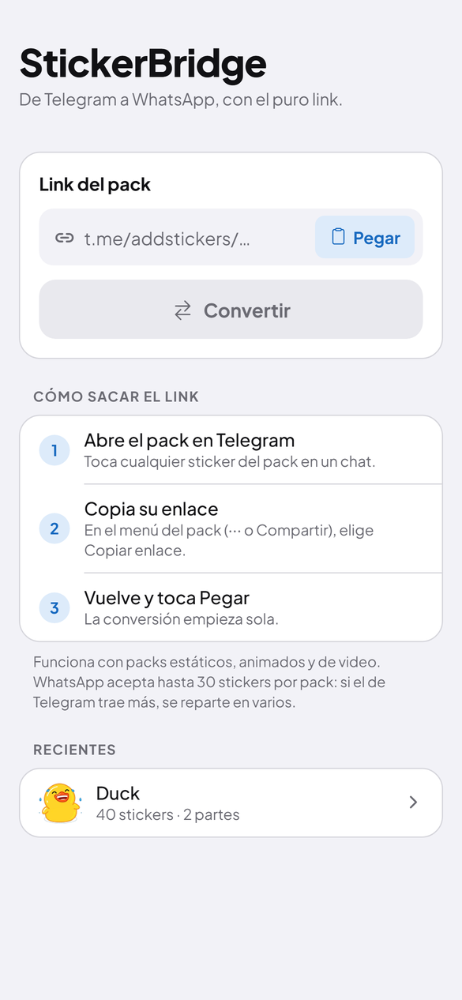
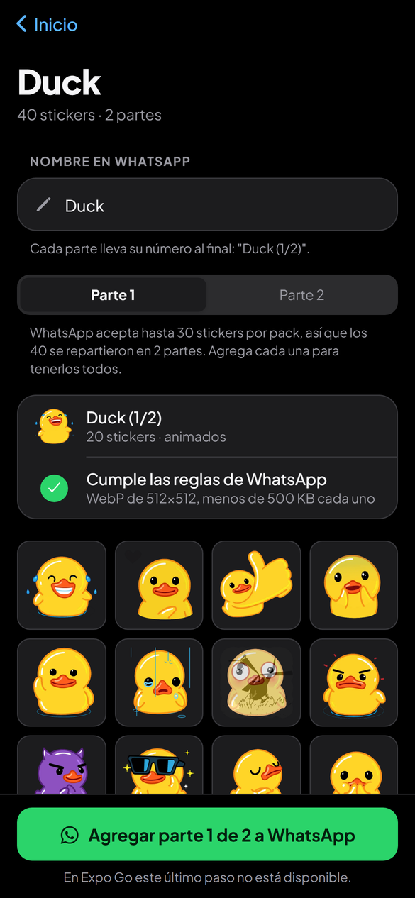
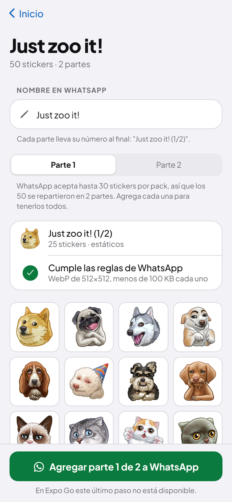
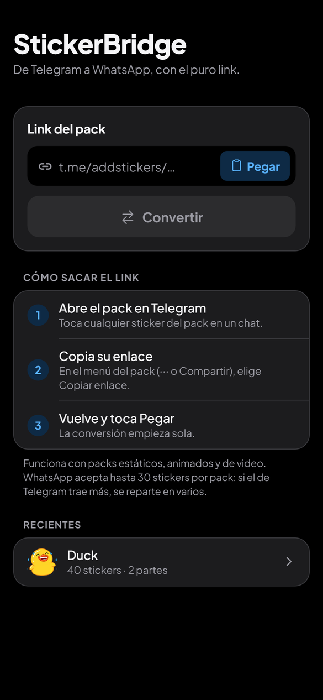
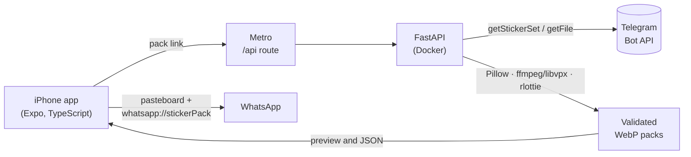

<div align="center">

# StickerBridge

**From Telegram to WhatsApp, with just the link.**

Paste the link of a Telegram sticker pack and the app turns it into packs that
WhatsApp accepts: static, animated and video stickers.

[](https://github.com/LxArmitage/stickerbridge/actions/workflows/pruebas.yml)


[Español](README.md) · **English**






<sub>The app's UI is in Spanish.</sub>

</div>

## What it does

1. **Paste the link** Telegram gives you when sharing a pack (`t.me/addstickers/Name`).
2. **The server downloads the pack** through the Telegram Bot API and converts each sticker:
   - static `.webp` → 512×512 WebP, up to 100 KB;
   - video `.webm` (VP9 with transparency) → animated WebP, up to 500 KB;
   - animated `.tgs` (Lottie) → rendered with rlottie → animated WebP, up to 500 KB.
3. **It splits them into packs of 3 to 30** (WhatsApp's limits), builds the tray icon and
   **validates every pack against WhatsApp's rules** before offering the button.
4. **The app shows a preview**, lets you rename the pack as it will appear in WhatsApp,
   and hands each part over to WhatsApp through a native Swift module.

Tested on a real iPhone: a 119-sticker video pack reached WhatsApp from the app.
Conversion was also tested with real static and animated (Lottie) packs.

## How it works



- The **bot token lives only on the server**; the app never sees it.
- In development the app doesn't talk to port 8000 directly: it goes through an **Expo
  Router API route** that forwards to the server. It works the same on the local network
  and over `expo start --tunnel`, with no firewall ports to open.
- Conversion runs in a **process pool** (CPU-bound) and downloads in threads (I/O-bound).
  The app polls progress every 800 ms and shows the stage: downloading, converting, done.
- Converted packs are **cached for 24 hours**: opening the same link again converts nothing.

## Technical challenges I solved

| Problem | Solution |
| --- | --- |
| ffmpeg's native VP9 decoder **drops the alpha channel** of video stickers: they came out with a black background. | Decode with `libvpx-vp9`, falling back to the default decoder only when the file isn't VP9. |
| Animated stickers must weigh **under 500 KB** without looking bad. | A ladder of fps, quality and alpha quality, with relative weights measured on real packs that **estimates which step will fit** and jumps straight to it. A 34-sticker animated pack went from 159 s to 46 s. |
| **libwebp merges identical frames** into one, and WhatsApp treats any one-frame sticker in an animated pack as static (rejecting the whole pack). | One invisible pixel of difference in the copied frame (alpha 0 → 1), verified at every compression quality. |
| WhatsApp **doesn't mix static and animated** stickers and requires **3 to 30 per pack**: a pack of 118 animated and 1 static sticker came out as 5 parts, one of them with the static sticker repeated 3 times. | When there are animated stickers, static ones are stored as 2-frame animations; everything goes together and is split evenly (31 → 16 + 15, never 30 + 1). |
| On iPhone, **WhatsApp rejects a pack without saying why**. | The server checks dimensions, file size, frames, duration, emojis and the tray icon before offering the button, and the app shows which rule fails. |
| WhatsApp identifies packs by ID: if the Telegram pack changes or the user renames it, **it's unclear whether WhatsApp updates or ignores it**. | The ID includes a hash of the content and of the chosen name: every version comes in as a new pack. |
| **Building for iPhone without a Mac** or a paid Apple Developer account. | Unsigned build on a [Codemagic](https://codemagic.io) Mac (`codemagic.yaml`) and install from Windows with Sideloadly and a free Apple ID. |

## Tech stack

- **App:** Expo 57, React Native 0.86, TypeScript, Expo Router (including API routes),
  Reanimated, a custom native module in **Swift** built with Expo Modules, Jest.
- **Server:** Python 3.11, FastAPI, Pillow, ffmpeg with libvpx, rlottie, httpx, pytest.
- **Infrastructure:** Docker Compose, nginx with Let's Encrypt HTTPS, GitHub Actions and
  Codemagic.

## Project layout

```
api/                       FastAPI server
  app/imports.py           Import flow, cache and /v1 routes
  app/telegram.py          From link to pack name; Bot API client
  app/stickers.py          Conversion: Pillow, ffmpeg/libvpx, rlottie
  app/whatsapp.py          WhatsApp rules, pack splitting, iOS JSON
  tests/                   Tests with synthetic stickers of all three types
movil/                     Expo app
  app/                     Screens (home, pack) and the API route that forwards to the server
  src/dominio/             Pure logic: link, progress, names (with tests)
  src/ui/                  iOS-style components, light and dark mode
  modules/whatsapp-stickers/   Native Swift module that hands the pack to WhatsApp
nginx/, docker-compose.yml HTTPS deployment
codemagic.yaml             iPhone build (unsigned .ipa)
```

## Running it locally

You need Docker, Node 24 and a Telegram bot (create one with [@BotFather](https://t.me/BotFather)).

```bash
cp .env.example .env        # then set TELEGRAM_BOT_TOKEN
docker compose -f docker-compose.dev.yml up --build
```

In another terminal:

```bash
cd movil
npm install
npx expo start --tunnel
```

- **Browser:** press `w` for the web version (everything but the last step).
- **Expo Go:** press `s` and scan the QR code. Everything works except "Add to WhatsApp",
  which needs the installed app.
- **App installed on the iPhone:** see below.

### Tests

```bash
# Server: converts synthetic stickers of all three types and checks WhatsApp's rules
docker compose -f docker-compose.dev.yml run --rm api python -m pytest -q

# App: types and logic
cd movil && npm run lint && npm test
```

### Installing on an iPhone (no Mac, no paid account)

1. Codemagic builds the `.ipa` from `codemagic.yaml` (500 free minutes a month); the
   steps are in `movil/scripts/compilar-ipa.sh`.
2. On Windows, [Sideloadly](https://sideloadly.io) installs it with a regular Apple ID.
3. On the iPhone: turn on **Developer Mode** and trust the Apple ID under
   **Settings → General → VPN & Device Management**.
4. With `npx expo start --tunnel` running, scan the QR code with the camera.

With a free Apple ID the app expires after 7 days; reinstall it with the same `.ipa`.

## Next steps

- **Android:** WhatsApp receives packs through a `ContentProvider`; the Android half of
  the native module is still missing.
- **Store release:** the installed app is a development build that loads its code from
  Metro; an App Store or Google Play release needs the server online and a bundled build.

## Author

**Alonso (ArmitaGG3)**, Systems Engineer · [GitHub](https://github.com/LxArmitage)

## License and disclaimer

Code under the [MIT](LICENSE) license. Personal project, not affiliated with Telegram or
WhatsApp. Stickers belong to their creators: the app only converts packs the user can
already see in Telegram, for personal use.
