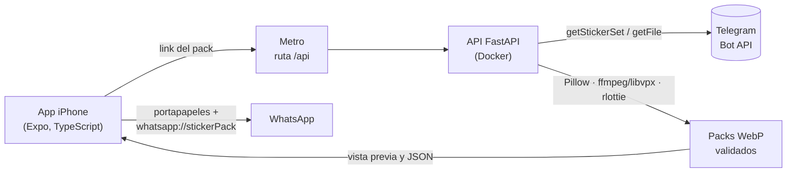

<div align="center">

# StickerBridge

**De Telegram a WhatsApp, con el puro link.**

Pegas el link de un pack de stickers de Telegram y la app lo convierte en packs
que WhatsApp acepta: estáticos, animados y de video.


**Español** · [English](README.en.md)


</div>

## Qué hace

1. **Pegas el link** que da Telegram al compartir un pack (`t.me/addstickers/Nombre`).
2. **El servidor baja el pack** con la Bot API de Telegram y convierte cada sticker:
   - estático `.webp` → WebP 512×512 de hasta 100 KB;
   - video `.webm` (VP9 con transparencia) → WebP animado de hasta 500 KB;
   - animado `.tgs` (Lottie) → se renderiza con rlottie → WebP animado de hasta 500 KB.
3. **Reparte en packs de 3 a 30**, que es lo que acepta WhatsApp, genera el ícono de
   bandeja y **valida cada pack contra las reglas de WhatsApp** antes de ofrecer el botón.
4. **La app muestra la vista previa**, deja cambiar el nombre con el que aparecerá en
   WhatsApp y entrega cada parte a WhatsApp con un módulo nativo en Swift.

Probado en un iPhone real: un pack de 119 stickers de video llegó a WhatsApp desde la app.
La conversión también se probó con packs reales estáticos y animados (Lottie).

## Cómo funciona



- El **token del bot vive sólo en el servidor**; la app nunca lo ve.
- En desarrollo, la app no habla directo con el puerto 8000: pasa por una **ruta API de
  Expo Router** que reenvía al servidor. Así funciona igual en la red local que con
  `expo start --tunnel`, sin abrir puertos en el firewall.
- La conversión corre en un **pool de procesos** (CPU) y la descarga en hilos (red). La
  app consulta el avance cada 800 ms y muestra la etapa: descargando, convirtiendo, listo.
- Lo convertido se guarda **24 horas**: abrir el mismo link otra vez no reconvierte nada.

## Retos técnicos que resolví

| Problema | Solución |
| --- | --- |
| El decodificador VP9 nativo de ffmpeg **descarta el canal alfa** de los stickers de video: salían con fondo negro. | Decodificar con `libvpx-vp9` y caer al decodificador por defecto sólo si el archivo no es VP9. |
| Los animados deben pesar **menos de 500 KB** sin verse mal. | Una escalera de fps, calidad y calidad del canal alfa, con un peso relativo medido en packs reales que **estima qué escalón cabe** y salta directo a él. Un pack de 34 animados pasó de 159 s a 46 s. |
| **libwebp funde los frames idénticos** en uno solo, y WhatsApp toma por estático todo sticker de un frame dentro de un pack animado (y rechaza el pack completo). | Un píxel invisible de diferencia en la copia del frame (alfa 0 → 1), comprobado con todas las calidades de compresión. |
| WhatsApp **no mezcla estáticos y animados** y exige **de 3 a 30 stickers** por pack: un pack de 118 animados y 1 estático salía en 5 partes, una de ellas con el estático repetido 3 veces. | Si hay animados, los estáticos se guardan como animados de 2 frames; todo va junto y se reparte parejo (31 → 16 + 15, nunca 30 + 1). |
| En iPhone, **WhatsApp rechaza un pack sin decir por qué**. | El servidor valida tamaño, peso, frames, duración, emojis e ícono de bandeja antes de ofrecer el botón, y la app muestra qué regla falla. |
| WhatsApp reconoce los packs por identificador: si el pack de Telegram cambia o el usuario lo renombra, **no queda claro si WhatsApp lo actualiza o lo ignora**. | El identificador incluye un hash del contenido y del nombre elegido: cada versión entra como pack nuevo. |
| **Compilar para iPhone sin Mac** y sin cuenta de Apple Developer. | Build sin firmar en una Mac de [Codemagic](https://codemagic.io) (`codemagic.yaml`) e instalación desde Windows con Sideloadly y un Apple ID gratuito. |

## Tecnologías

- **App:** Expo 57, React Native 0.86, TypeScript, Expo Router (incluidas rutas API),
  Reanimated, un módulo nativo propio en **Swift** con Expo Modules, Jest.
- **Servidor:** Python 3.11, FastAPI, Pillow, ffmpeg con libvpx, rlottie, httpx, pytest.
- **Infraestructura:** Docker Compose, nginx con HTTPS de Let's Encrypt, GitHub Actions
  y Codemagic.

## Estructura

```
api/                       Servidor FastAPI
  app/imports.py           Flujo de importación, caché y rutas /v1
  app/telegram.py          Del link al nombre del pack; cliente de la Bot API
  app/stickers.py          Conversión: Pillow, ffmpeg/libvpx, rlottie
  app/whatsapp.py          Reglas de WhatsApp, reparto en packs, JSON para iOS
  tests/                   Pruebas con stickers sintéticos de los tres tipos
movil/                     App Expo
  app/                     Pantallas (inicio, pack) y la ruta API que reenvía al servidor
  src/dominio/             Lógica pura: link, progreso, nombres (con pruebas)
  src/ui/                  Componentes con el lenguaje visual de iOS, modo claro y oscuro
  modules/whatsapp-stickers/   Módulo nativo en Swift que entrega el pack a WhatsApp
nginx/, docker-compose.yml Despliegue con HTTPS
codemagic.yaml             Build de iPhone (.ipa sin firmar)
```

## Correrlo en tu computadora

Necesitas Docker, Node 24 y un bot de Telegram (créalo con [@BotFather](https://t.me/BotFather)).

```bash
cp .env.example .env        # y pon tu TELEGRAM_BOT_TOKEN
docker compose -f docker-compose.dev.yml up --build
```

En otra terminal:

```bash
cd movil
npm install
npx expo start --tunnel
```

- **Navegador:** presiona `w` para abrir la versión web (todo menos el último paso).
- **Expo Go:** presiona `s` y escanea el QR. Se prueba todo menos "Agregar a WhatsApp",
  que necesita la app instalada.
- **App instalada en el iPhone:** ver abajo.

### Pruebas

```bash
# Servidor: convierte stickers sintéticos de los tres tipos y valida las reglas de WhatsApp
docker compose -f docker-compose.dev.yml run --rm api python -m pytest -q

# App: tipos y lógica
cd movil && npm run lint && npm test
```

### Instalar la app en el iPhone (sin Mac ni cuenta de pago)

1. Codemagic compila el `.ipa` con `codemagic.yaml` (500 minutos gratis al mes); los pasos
   están en `movil/scripts/compilar-ipa.sh`.
2. En Windows, [Sideloadly](https://sideloadly.io) lo instala con un Apple ID normal.
3. En el iPhone: activar el **Modo de desarrollador** y confiar en el Apple ID en
   **Ajustes → General → VPN y gestión de dispositivos**.
4. Con `npx expo start --tunnel` corriendo, escanear el QR con la cámara.

Con un Apple ID gratuito la app caduca a los 7 días y se reinstala con el mismo `.ipa`.

## Pendiente

- **Android:** WhatsApp recibe los packs por un `ContentProvider`; falta la mitad Android
  del módulo nativo.
- **Versión de tienda:** la app instalada es una build de desarrollo que toma el código
  de Metro; una versión para App Store o Google Play necesita el servidor en línea y el
  código empaquetado.

## Autor

**Oswaldo Campos** (ArmitaGG3), Ingeniero en Sistemas · [GitHub](https://github.com/LxArmitage)

## Licencia y aviso

Código bajo licencia [MIT](LICENSE). Proyecto personal, sin relación con Telegram ni
con WhatsApp. Los stickers pertenecen a sus autores: la app sólo convierte packs que el
usuario ya puede ver en Telegram, para su uso personal.
